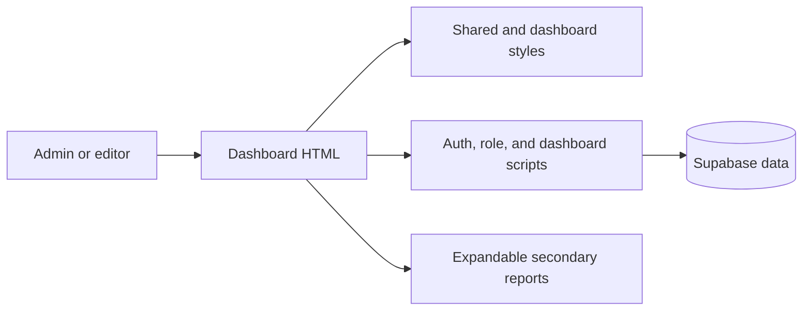

# High-Level Design: APSG Admin Dashboard

## Problem

The APSG admin dashboard presents repeated membership totals, data-quality indicators, operational tables, publishing status, and website analytics in many separate panels. The volume and repetition make it difficult for administrators to identify the most useful membership and record-completion information quickly.

## Approach

Keep the dashboard as a single page with a clear first view for membership management. Show four primary indicators, member data health and follow-up actions, one registration trend, and the latest members. Place publishing, website analytics, geographic rankings, and detailed incomplete-record reporting in an expandable “More reports” area.

The dashboard continues to use its existing static HTML, styles, browser scripts, role checks, and Supabase-backed data. The layout change reorganizes presentation while retaining the current calculations, navigation destinations, and administrative actions.

## Target Users

- Administrators who monitor membership totals, recent registrations, and incomplete records.
- Editors who use dashboard shortcuts to reach publishing tools.
- Read-only staff who review membership and website summaries.

## Goals

- Put the core membership overview and member follow-up actions at the top of the page.
- Remove repeated presentation of the same time-period counts and status totals.
- Keep secondary reports reachable without making them compete with daily membership work.
- Preserve current data sources, role access, exports, themes, links, and responsive behavior.
- Make the dashboard easier to scan on both desktop and mobile screens.

## Non-Goals

- Changing the Supabase schema, membership data, queries, or authentication rules.
- Redesigning other admin pages or the public website.
- Adding new analytics, reports, or data-entry workflows.
- Publishing a production deployment as part of the design work.

## Tenets

- **Action before analysis.** Put membership review and record follow-up ahead of publishing and traffic reports.
- **Progressive disclosure over simultaneous visibility.** Keep secondary reports available while reducing the first view's visual load.
- **Use existing data over presentation-only metrics.** A cleaner screen must not create or imply new calculations.

## System Design

The production site is a static Netlify Drop deployment. The dashboard HTML loads shared styles and browser scripts for Supabase access, administrator authentication, role-aware navigation, and dashboard data rendering. The redesign changes the dashboard's presentation structure and styles while keeping the existing data-rendering identifiers and external behavior stable.

## Key Design Decisions

| Decision | Chosen | Alternatives considered | Rationale |
|---|---|---|---|
| Dashboard navigation model | One focused page with an expandable “More reports” area | Separate overview/operations tabs; preserve the current long page with collapsed sections | The chosen model reduces the first-view load without adding tab state or hiding the member workflow behind another screen. |
| Data behavior | Keep existing calculations, identifiers, permissions, and actions | Rewrite queries or consolidate dashboard data in a new service | The request is about clarity; retaining existing data behavior limits risk to membership operations. |

## Success Metrics

- The initial desktop view presents no more than four primary metric cards and contains the key member follow-up area.
- The initial view contains only one registration trend and one latest-members list.
- Secondary report content remains reachable from “More reports.”
- Existing administrator role behavior and dashboard actions continue to work.
- The dashboard remains readable at mobile widths without horizontal page scrolling.

## References

- Production dashboard: `https://apsgnigeria.org/admin/dashboard.html`
- Netlify project: `https://app.netlify.com/projects/fanciful-cactus-60e3ba/overview`
