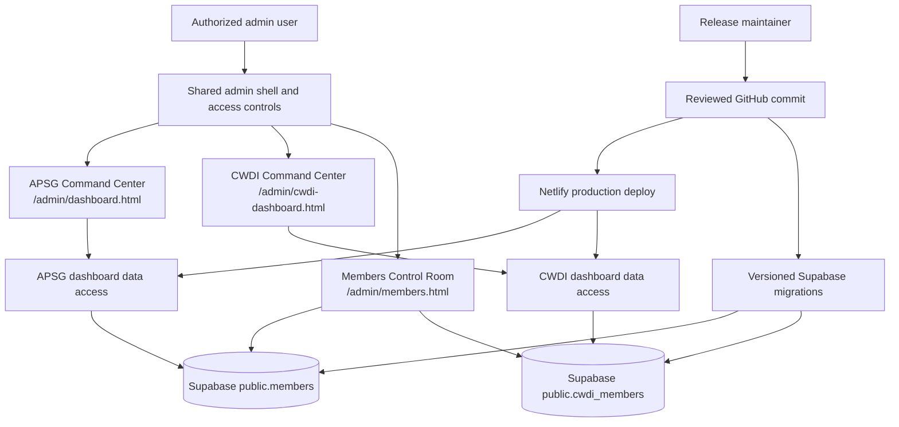

# High-Level Design: APSG/CWDI Website and Admin Workspace

## Problem

APSG and the Confidence Women Development Initiative (CWDI) maintain separate membership registries but need clear, useful administrative views of those records. A dashboard that combines both registries makes organization-specific totals, activity, and data quality difficult to interpret. CWDI also needs an administrative command center that is easy to find and familiar to administrators who already use the APSG dashboard.

The public website, Supabase database, and hosted site also need one reviewable release path. The website is published separately from its GitHub source, and database changes do not have a tracked production migration history. This makes it difficult to know which code and schema belong together or to recover confidently from a failed release.

## Approach

Provide one command center for each organization inside the existing admin workspace. The APSG Command Center reads APSG membership data from `public.members`; the CWDI Command Center reads CWDI membership data from `public.cwdi_members`. Each page calculates and presents its own organization’s membership information. Neither page combines the registries.

Both pages use the existing admin shell, navigation, identity controls, access rules, and visual conventions. Organization-specific pages keep their own titles, links, data hooks, and registry queries. The current Supabase registries remain the source of truth.

The shared Members Control Room is an administrative record-management surface rather than an organization command center. Authorized administrators may view source-tagged APSG and CWDI rows in the same list. Each row remains owned by its original registry, and its details, edits, and deletion stay routed to that registry. This operational list does not combine records into a unified member or add combined command-center metrics.

### Production Releases

Use `Worththanks/apsgnigeria` as the reviewed source for website code and ordered Supabase migrations. Reconcile the production schema before creating a migration baseline; the production database remains authoritative for existing member and organizational records. Database changes are applied from reviewed, versioned migrations through an explicit release step. Netlify production deploys use a reviewed GitHub commit after the matching database changes and release checks are ready. Do not import local test records or replace live production data as part of a schema release.

Keep application and database releases compatible across the transition. Prefer additive database changes that allow the currently deployed site and the incoming site to operate during the release. Before production release, resolve critical public data-access findings, rotate the previously exposed privileged Supabase credential, review function privileges, and verify database recovery readiness.

## Target Users

- **APSG administrators and staff** need a concise view of APSG registration activity, record completeness, and follow-up work, with direct access to APSG member records.
- **CWDI administrators and staff** need the corresponding view of CWDI registration activity and records, without APSG figures mixed into CWDI reporting.
- **Read-only dashboard users** need organization-specific summaries and navigation that respect their existing access level.
- **Release maintainers** need to trace a production site to reviewed source and apply database changes with a verified recovery path.

## Goals

- Provide a distinct CWDI Command Center in the admin workspace, alongside the APSG Command Center.
- Keep all APSG dashboard counts, trends, rankings, and member lists derived from `public.members` only.
- Keep all CWDI dashboard counts, trends, rankings, and member lists derived from `public.cwdi_members` only.
- Preserve shared administration conventions and existing role-based access behavior.
- Make each organization’s dashboard route and title clear in navigation and page content.
- Keep shared member-list actions scoped to the registry that owns the selected row.
- Keep the production website deployable from a reviewed GitHub commit.
- Track the production database's deliberate schema and function changes in an ordered migration history.
- Preserve existing production member data while releasing schema, function, and access-policy changes.
- Make a failed release recoverable through a known-good site deploy and a verified database recovery path.

## Non-Goals

- Combining APSG and CWDI member records into a unified stored member or presenting cross-organization command-center totals.
- Copying local test or member records into production, replacing production records, or merging the APSG and CWDI registries.
- Replacing Netlify or Supabase, redesigning the website, or making database migrations run automatically on every source push.
- Adding a new organization-wide analytics product or changing unrelated admin pages.

## Tenets

- **Explicit ownership over convenience.** Prefer registry-scoped views, source-owned actions, and familiar admin patterns over shortcuts that obscure organization boundaries.
- **Observed state over assumptions.** Prefer values present in a registry and verified production state over inferred details or unverified local files.
- **Auditable compatibility over release speed.** Prefer reviewable, versioned changes that support a staged app/database transition over opaque one-step cutovers.

## System Design

Each command center owns its registry selection and organization-specific dashboard calculations. The shared shell provides common navigation, account controls, and access behavior; it does not merge the page data. Both registries remain in Supabase and are accessed under policies reviewed for the current application.

The Members Control Room loads each registry separately and tags rows with their source before presenting the combined administrative list. It uses the source tag to select the owning registry for row-level actions. This shared record-management view does not change the command centers' registry boundaries or aggregate their metrics.

The website source and Supabase migrations are reviewed together in GitHub. Netlify deploys a selected reviewed commit. Database migrations are applied as an explicit step from the same source history rather than being run automatically by a website build. The release keeps existing production records in place and records schema changes in order so operators can identify the expected database state for each deployed site version.

## Key Design Decisions

| Decision | Alternatives considered | Rationale |
|---|---|---|
| Give CWDI a separate dashboard route | Add an organization switcher to the APSG page; place both organizations’ panels side by side | A separate route makes the active organization explicit and keeps its metrics and member views focused. It also gives CWDI room to evolve without changing APSG’s page structure. |
| Scope each command center to its own registry | Continue combining both tables; build a shared cross-organization dashboard | The two registries represent different organizations and need interpretable organization-specific figures. A combined view would require separate labeling and aggregation rules beyond this request. |
| Reuse the admin shell and conventions | Build an independent CWDI admin application | Reuse keeps navigation and access behavior consistent while separate page-level data access preserves registry boundaries. |
| Keep the existing registries and identifiers | Create a unified membership table or issue new identifiers | Existing registries already own their organizations’ records and identifiers; evolving them in place preserves ownership and established references without introducing a unified membership model. |
| Allow a shared administrative member list while retaining source ownership | Restrict the Members Control Room to one organization; merge member records into a shared registry | Administrators need to manage both organizations' records in one operational list, while distinct source tags keep every row action in its owning registry and command-center reporting organization-specific. |
| Keep production database changes explicit and versioned | Apply SQL directly in the dashboard without a migration record; automatically run production migrations on every site build | A reviewed, ordered migration history improves auditability, while a separate apply step keeps a website deploy from unexpectedly changing production data structures. |
| Connect Netlify to reviewed GitHub releases | Continue publishing unrelated upload bundles; deploy every working branch to production | A commit-linked production deploy makes the live site traceable to source while keeping preview work separate from production. |
| Preserve production records during schema releases | Seed or replace live records from local development data | Existing production records remain the source of truth; schema changes can be introduced without copying test data or overwriting member information. |

## Success Metrics

- APSG dashboard total and member list match records read from `public.members`.
- CWDI dashboard total and member list match records read from `public.cwdi_members`.
- Loading CWDI records does not change APSG metrics, and loading APSG records does not change CWDI metrics.
- Authorized users can reach each command center from the shared admin navigation, and existing access controls remain effective.
- Each page identifies its organization in the page title and dashboard heading.
- A Members Control Room action on a CWDI row targets `public.cwdi_members`; an APSG row action targets `public.members`.
- The published Netlify site identifies the GitHub commit from which it was deployed.
- Each production schema change is represented by an ordered migration whose recorded state matches the production database.
- A production release does not copy local member records or replace existing production records.
- A failed website release can return to a known-good deploy, and the database has a verified recovery path before migrations are applied.
- Public roles cannot read sensitive member columns, and every exposed object has an explicitly reviewed access policy.

## References

- [APSG dashboard design](intent/dashboard/dashboard-design.md)
- [APSG dashboard requirements](intent/dashboard/dashboard-specs.md)
- [Registration presentation design](intent/registration/registration-design.md)
- [Registration field design](intent/registration-form-fields/registration-form-fields-design.md)
- [Registration lookup design](intent/registration-member-lookup/registration-member-lookup-design.md)
- [Registration submission design](intent/registration-submission/registration-submission-design.md)
- [Registration organization branding design](intent/registration-organization-branding/registration-organization-branding-design.md)
- [Production release design](intent/production-release/production-release-design.md)
- Supabase registries: `public.members` and `public.cwdi_members`
- GitHub source: `Worththanks/apsgnigeria`
- Production hosting: Netlify project for `apsgnigeria.org`
